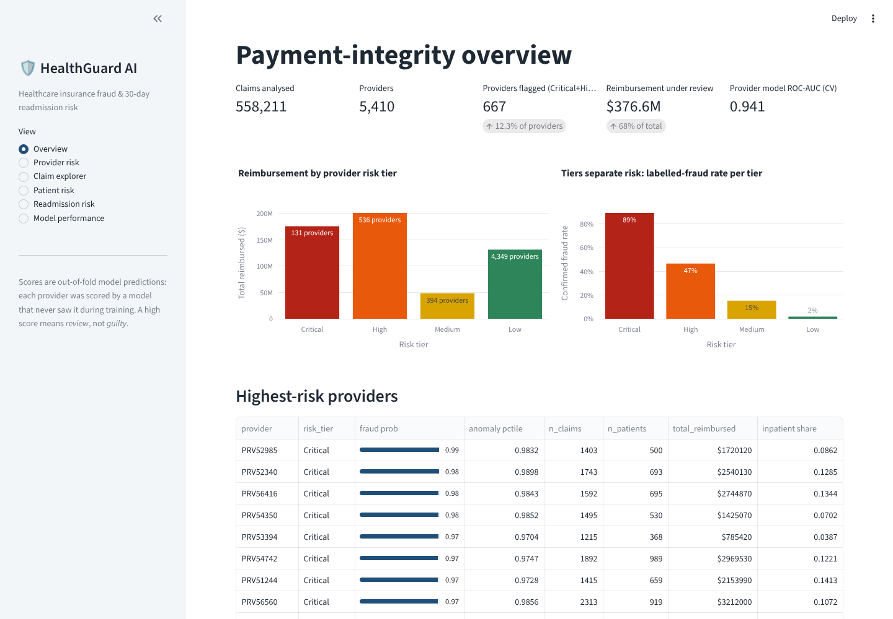
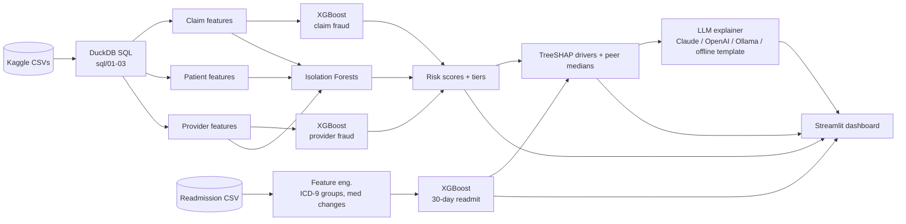
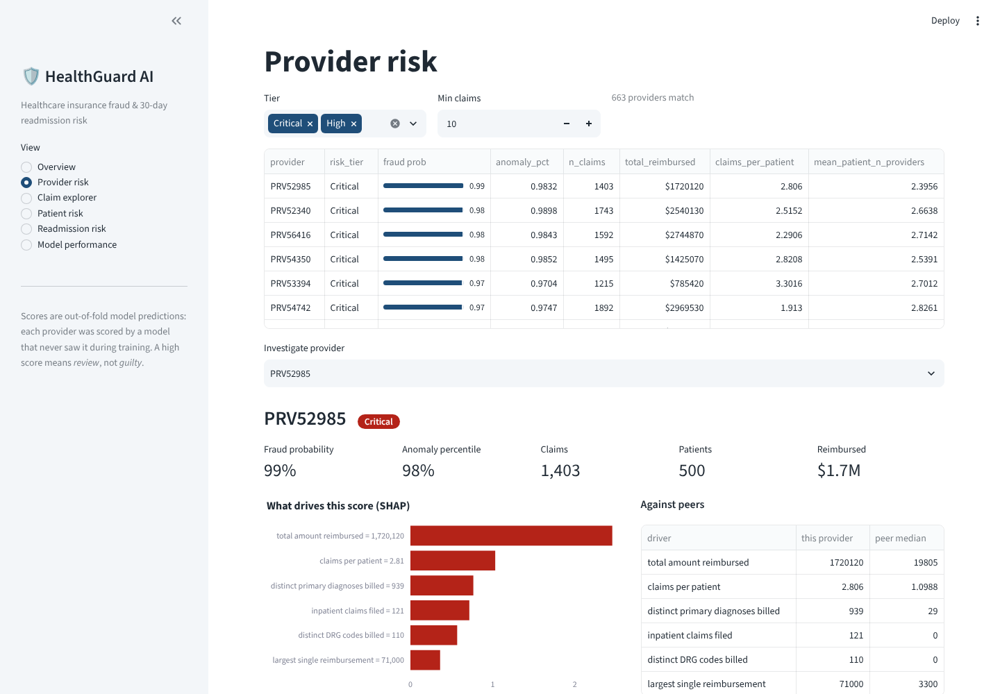

# HealthGuard AI — Healthcare Insurance Fraud & Readmission Risk Platform

End-to-end healthcare risk analytics: **insurance-claim fraud detection**, **unsupervised anomaly detection**, and **30-day hospital readmission prediction**, with **SHAP** explanations, an **LLM explanation layer** that turns model output into analyst-readable summaries, and an interactive **Streamlit** dashboard for claim-, patient- and provider-level review.

`Python · SQL (DuckDB) · XGBoost · Scikit-learn · SHAP · LLM · Streamlit · Plotly`



---

## Results (held-out data)

| Model | Level | Metric | Result |
|---|---|---|---|
| XGBoost fraud classifier | Provider (5,410) | ROC-AUC, 5-fold × 2 repeated CV | **0.941 ± 0.006** |
| | | PR-AUC (base rate 9.4%) | **0.69** (≈7× random) |
| | | Holdout recall / precision @ best-F1 threshold | **79% / 62%** |
| | | Fraudulent providers caught reviewing top 10% | **71%** (7.1× lift) |
| Risk tiers (out-of-fold) | Provider | Labelled-fraud rate: Critical / High / Medium / Low | **89% / 47% / 15% / 2%** |
| Isolation Forest (no labels) | Provider | ROC-AUC vs fraud labels | **0.82**; top-5% = 4.0× lift |
| XGBoost readmission | Encounter (99,343) | ROC-AUC (patient-grouped holdout) | **0.683** (LogReg baseline 0.667) |
| | | Observed readmission: High / Medium / Low band | **28.5% / 15.1% / 7.4%** |

The Critical + High tiers flag **667 providers (12% of providers)** that account for **68% ($377M)** of total reimbursement — a focused audit queue.

**Honest notes** — the numbers a reviewer will ask about:
- On provider fraud, XGBoost is only slightly ahead of a well-regularised logistic regression (0.941 vs 0.936 CV ROC-AUC). The aggregated SQL features do most of the work; XGBoost adds non-linear interactions and exact TreeSHAP explanations.
- The single 20% holdout contains ~100 fraudulent providers, so its ROC-AUC (0.964) is noisier than the repeated-CV figure — CV is the headline.
- Claim-level fraud (ROC-AUC 0.65) is weak because the labels exist only at provider level; claims inherit their provider's label. Claim-level Isolation Forest is ~random (0.52): fraud in this data shows up in *billing patterns across a provider's book*, not in individually odd claims. That is why claim risk blends provider probability, claim probability and anomaly percentile.
- Readmission AUC of ~0.68 is in line with published work on this dataset (typically 0.64–0.70); readmission is hard to predict from administrative data. The model is well calibrated, which matters more for care-management triage than raw AUC.

---

## Data (Kaggle)

| Dataset | Kaggle slug | Used for |
|---|---|---|
| Healthcare Provider Fraud Detection Analysis | `rohitrox/healthcare-provider-fraud-detection-analysis` | 558,211 inpatient + outpatient claims, 138,556 beneficiaries, 5,410 labelled providers |
| Diabetes 130-US Hospitals (1999–2008) | `brandao/diabetes` | 101,766 encounters with readmission outcome (`<30`, `>30`, `NO`) |

Data is downloaded by `scripts/download_data.py` and is **not** committed (see `.gitignore`).

---

## Architecture



### 1 · SQL feature engineering (`sql/`, run by DuckDB)
- **Claim level** — amount vs. clinical peer group (same DRG for inpatient / same primary diagnosis for outpatient, shrunk for small groups), length of stay, claim duration, diagnosis/procedure counts, physicians on claim, attending = operating, duplicate same-day claims, patient context, attending-physician volume and how many providers that physician bills through.
- **Patient level** — providers visited (doctor-shopping), claims, chronic-condition count, spend, duplicate claims.
- **Provider level** — 35 aggregates: volume, inpatient share, claims per patient, reimbursement distribution, share of claims billed >2× peers, physician network spread, geographic spread of the patient base, diagnosis/DRG diversity, patient case-mix.

### 2 · Models (`src/healthguard/`)
- **Provider fraud** — XGBoost (`max_depth=3`, 800 trees, chosen by 5-fold CV on the training split only) with a logistic-regression baseline.
- **Claim fraud** — XGBoost on claim + patient features; claims inherit the provider label.
- **Anomaly detection** — Isolation Forests on log-scaled claim, provider and patient features, fitted without labels.
- **Risk tiers** — provider: *Critical* = probability ≥ the threshold that gave 85% precision out-of-fold, *High* = best-F1 threshold, *Medium* = half that or top-3% anomaly; claim / patient: blended score, top 2% / next 8% / next 20%.
- **Readmission** — XGBoost with native categoricals and early stopping; ICD-9 chapter grouping, medication-change counts, HbA1c / glucose flags, prior utilisation, and prior encounters for the same patient (counting only earlier encounters).

**Leakage controls:** provider and claim models share one provider-stratified split, so a provider's claims are never in both train and test; dashboard scores are 5-fold **out-of-fold** predictions; the readmission split is **grouped by patient** (patients have up to 40 encounters); expired/hospice discharges are removed from readmission data.

### 3 · Explainability + LLM layer
- `explain.py` computes exact TreeSHAP contributions with XGBoost (`pred_contribs`) and maps every feature to plain English.
- `llm_explainer.py` sends **only structured facts** (score, tier, top SHAP drivers with values and peer medians) to an LLM with a system prompt that forbids inventing facts or accusing anyone, and asks for a headline, key drivers and one proportionate next step.
- Backends: Anthropic Claude (`ANTHROPIC_API_KEY`), OpenAI (`OPENAI_API_KEY`), local Ollama (`OLLAMA_HOST`), or a deterministic **offline template** used automatically when no key is set or a call fails — the app never breaks without an API key.

### 4 · Dashboard (`app/streamlit_app.py`)
| Page | What it does |
|---|---|
| Overview | KPIs, reimbursement and labelled-fraud rate by tier, top-risk providers |
| Provider risk | Filterable queue → SHAP drivers, peer comparison, LLM summary, riskiest claims |
| Claim explorer | Supervised vs anomaly scatter, filters, per-claim SHAP + summary |
| Patient risk | Provider-hopping, patients' unusual attributes (z-scores), claim history |
| Readmission risk | Bands vs observed rates, calibration, editable what-if scorer with SHAP + summary |
| Model performance | Holdout metrics, baselines, ROC / PR curves, global SHAP plots |



---

## Run it

```bash
git clone https://github.com/nirdoshk0228/healthguard-ai.git
cd healthguard-ai
python -m venv .venv && source .venv/bin/activate     # Windows: .venv\Scripts\activate
pip install -r requirements.txt

# The raw Kaggle CSVs ship in data/raw/ in the project zip, so this step just skips.
# On a fresh clone (data is git-ignored) it downloads them; it needs a Kaggle API token:
# Kaggle → Settings → API → Create New Token → save to ~/.kaggle/kaggle.json
python scripts/download_data.py
python run_pipeline.py            # ~3 minutes: SQL features → models → metrics → SHAP plots
streamlit run app/streamlit_app.py

# optional: real LLM summaries instead of the offline template
pip install anthropic && export ANTHROPIC_API_KEY=...   # or OPENAI_API_KEY / OLLAMA_HOST
pytest -q
```

## Repository layout

```
healthguard-ai/
├── app/streamlit_app.py          # dashboard
├── scripts/download_data.py      # Kaggle download (kagglehub, falls back to kaggle CLI)
├── sql/                          # DuckDB feature engineering
│   ├── 01_claims.sql
│   ├── 02_patients_physicians.sql
│   └── 03_providers.sql
├── src/healthguard/
│   ├── config.py                 # paths, dataset slugs
│   ├── features_fraud.py         # runs the SQL, defines feature sets
│   ├── features_readmission.py   # ICD-9 grouping, medication features
│   ├── train_fraud.py            # XGBoost + Isolation Forest + tiers + SHAP
│   ├── train_readmission.py      # XGBoost + baseline + calibration + SHAP
│   ├── explain.py                # TreeSHAP + plain-English feature labels
│   ├── llm_explainer.py          # Claude / OpenAI / Ollama / template
│   ├── scoring.py                # builds explainable cases for the app
│   └── metrics.py
├── reports/                      # metrics_*.json, SHAP figures
├── tests/test_core.py
└── run_pipeline.py
```

## Limitations
- The fraud dataset is a public, Medicare-style teaching dataset; labels are provider-level "potential fraud" flags, not adjudicated cases.
- Scores prioritise review — they are not evidence. The LLM layer is constrained to model facts and phrased for a human reviewer.
- Readmission features are administrative; adding social determinants, follow-up scheduling or prior-claims history would be the next lift.
